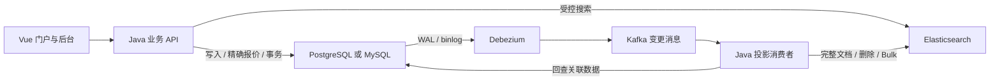

# ES 框架学习篇：旅游门户完整系统规划

修订日期：2026-10-12。用户已明确第一部分为学习核心，至少 30 课，要求大量业务案例、评分排序、景点/酒店/房型，以及 PostgreSQL/MySQL 日志到 ES 的变更链路。本版确定 **45 节核心课、155 个核心案例**，替代最初的 14 课方案。当前完成的是规划；课程、前后端工程和案例均待实现与真实验收。进度见 [STATUS.md](STATUS.md)，案例清单见 [FRAMEWORK_CASES.md](FRAMEWORK_CASES.md)。

## 1. 第一部分的定位与最终交付

第一部分是「ES 框架学习篇：从零搭建旅游门户」，课程内容与可运行的实战工程并行推进。所有课程围绕同一个系统，不在每课更换业务。学习路线是业务需求 → 数据来源 → 索引设计 → 查询/中文搜索 → 评分/房型排序 → 前后端 → 门户业务闭环 → 日志变更同步 → 运行验收。

第二部分仍是「ES 源码篇」，现有 Chapter 01–30、路径、实验 ID 与六篇结构保留，按用户指定章节继续重构。两部分分别记录课程与验收进度。F 编号目前尚无已发布页面，本轮可以扩展到 F45；源码 ch 编号不重排。

完成第一部分后应交付：

- Vue 前台：门户首页、目的地、景点搜索与详情、酒店搜索与详情、房型/日期报价、收藏、点评、教学订单。
- Vue 管理后台：目的地/景点/酒店/房型维护，价格与每日库存编辑、上下架、点评管理、同步状态与搜索预览。
- Java 后端：业务 API、数据库事务、受控 ES 查询、报价与教学预订、CDC 投影消费者、错误与运行观测。
- 数据与基础设施：PostgreSQL 主线、MySQL 等价实验、Elasticsearch、Kafka、Debezium、迁移 SQL、固定样本、数据生成器与 Docker Compose。
- 按课代码入口、可运行的阶段快照、155 个案例的准备/执行/结果断言/清理流程、最终启动与部署说明。

教学订单包含创建、库存校验/扣减、模拟确认、取消与库存释放；支付使用明确标注的模拟确认，不接外部支付。住宿数据是教学生成数据，系统验证多人抢最后一间房等一致性问题。

## 2. 45 节核心课目录

九个单元，每单元 5 课。常规课 3 个核心案例；F16–F25 的评分与酒店/房型专题每课 5 个，共 35×3 + 10×5 = **155 个案例**。案例是独立业务场景，不按 HTTP 操作卡、代码行或同一请求的重复点击计数。

### 单元一 · 从空项目到真实数据（F01–F05）

| 编号 | 课程 | 本课交付/实验 |
| --- | --- | --- |
| F01 | 旅游门户需求、搜索契约与系统分工 | 从空目录建立前后端工程骨架、页面路由与健康 API；列出景点/酒店/房型用户旅程 |
| F02 | 本地环境、ES 启动、连接与基础观察 | Docker 配置、真实版本/健康检查、首条文档写入与搜索；形成可运行的基础环境 |
| F03 | 数据从哪里来：数据库模型、SQL 迁移与样本 | 目的地、景点、酒店、房型、价目计划、每日价格/库存、用户/点评/订单 ER 模型及 seed |
| F04 | 从业务表到搜索索引：mapping 与文档边界 | text/keyword、金额/日期、geo_point、数组/object/nested；显式建索引与字段契约 |
| F05 | 全量导入、CRUD、Bulk、刷新与重做 | 数据库抽取 → 搜索文档组装 → Bulk，固定 ID、条级失败、清理重做、基础 read/write alias |

### 单元二 · 景点搜索的完整功能（F06–F10）

| 编号 | 课程 | 本课交付/实验 |
| --- | --- | --- |
| F06 | 关键词查询：match、term、phrase、bool | 名称/描述搜索，精确与全文匹配、词序、AND/OR 的业务差异 |
| F07 | 城市、主题、价格、状态与附近筛选 | 多条件查询，价格边界、标签多选与距离；下架项在搜索/提示中统一排除 |
| F08 | 多字段召回与字段组织 | multi_match、标题/别名/描述分工、copy_to 对照、精确名与模糊词的不同请求 |
| F09 | 筛选项与聚合计数 | 城市/主题/价格区间统计，query/post_filter、同维多选与跨维组合的计数语义 |
| F10 | 高亮、排序、浅分页与 PIT 游标 | 返回 DTO、高亮、完整 sort、稳定第二排序键；游标过期与改变条件的恢复 |

### 单元三 · 中文搜索研究（F11–F15）

| 编号 | 课程 | 本课交付/实验 |
| --- | --- | --- |
| F11 | 中文分析链与索引/查询分词 | 用 _analyze 观察 token/position/offset；解释文档有词但查询找不到 |
| F12 | standard、SmartCN、ICU、IK 的真实对照 | 相同旅游语料、相同查询与标注，验证插件版本、中文/中英混合及歧义词 |
| F13 | 旅游专有词与词典管理 | 景点/酒店/品牌新词；词典更新、旧索引词不变、重建对照 |
| F14 | 别名、同义词、繁简与短语 | 故宫/紫禁城、跨词同义词、同名景点歧义；搜索分析链与短语结果 |
| F15 | 输入提示、拼音与容错 | 中文前缀/拼音辅助字段、提示去重、错拼边界与热门词；独立验证插件与误匹配 |

### 单元四 · 景点评分与排序（F16–F20）

| 编号 | 课程 | 本课交付/实验 |
| --- | --- | --- |
| F16 | _score 从哪里来：BM25 与 _explain | 词频、稀有词、字段长度、过滤与评分；解释两个景点的次序而非背公式 |
| F17 | 精确名称、短语、多字段权重 | 标题/别名/描述权重，精确匹配优先策略、should/minimum_should_match 与 dis_max |
| F18 | 点评质量、评论数、热度与业务评分 | function_score、field_value_factor/rank_feature 候选；尺度、缺值、封顶、小样本点评修正 |
| F19 | 附近、时效、营业状态与排序策略 | 距离/时间衰减、score_mode/boost_mode、相关性/距离/价格独立模式及稳定顺序 |
| F20 | 用案例集验证排序，而不是凭感觉调参 | Recall@10/nDCG@10、留出查询、失败案例、权重实验与可复查的结果解释 |

### 单元五 · 酒店、房型与真实报价（F21–F25）

| 编号 | 课程 | 本课交付/实验 |
| --- | --- | --- |
| F21 | 酒店/房型/价目计划如何建立搜索文档 | 酒店主文档、nested 房型、独立房型/offer 索引的取舍，数据量与更新成本 |
| F22 | 同一房型必须满足全部条件 | object 串房型反例、nested 查询与 sort filter、床型/早餐/人数/退改条件一致 |
| F23 | 多晚入住：逐晚价格、库存与可售判断 | 入住含/离店不含、缺一晚、某晚售罄、价目计划、最短入住；数据库给出准确报价 |
| F24 | 酒店聚合与“符合条件的最低价” | 房型命中后按酒店展示、collapse/inner_hits 与酒店数；最低价取满足全部条件的报价 |
| F25 | 酒店与房型怎么排：相关性、品质、距离、总价 | 酒店级/房型级分开排序，用户显式偏好、单晚起价与多晚总价区别、候选复核与顺序契约 |

### 单元六 · Java 与前端搜索页（F26–F30）

| 编号 | 课程 | 本课交付/实验 |
| --- | --- | --- |
| F26 | 官方 Java 客户端与可运行的请求代码 | Maven、客户端复用/关闭、连接配置、REST DSL 与 Java 对照、对象映射/Bulk 结果 |
| F27 | Spring Boot 搜索 API 与数据契约 | Controller/Service/DTO、分页与排序参数、校验/超时/错误；前端只传业务条件 |
| F28 | Vue 搜索页：输入、筛选、结果与 URL 状态 | 景点列表、筛选组件、结果卡片、排序、分页、条件分享/返回恢复；调用真实 Java API |
| F29 | 酒店详情、房型列表与日期报价联调 | 日期/人数输入、房型条件、价目计划展示、库存/报价 API 与价格变化反馈 |
| F30 | 前端搜索体验与失败恢复 | 防抖/取消/旧响应竞态、提示键盘操作、空结果/超时、可访问性、双主题与窄屏 |

### 单元七 · 旅游门户业务闭环（F31–F35）

| 编号 | 课程 | 本课交付/实验 |
| --- | --- | --- |
| F31 | 门户首页、目的地页与分类搜索 | 热门目的地、景点/酒店入口、攻略内容与分类结果；各类型评分独立调优 |
| F32 | 注册登录、收藏与搜索历史 | 用户会话、资源权限、收藏/取消、历史列表；前后端代码与数据库持久化 |
| F33 | 点评发布、审核与评分数据更新 | 点评/评论数聚合、审核状态、异常点评案例；把排序信号写回业务数据 |
| F34 | 管理后台：内容、房型、价格、库存与上下架 | CRUD 表单/校验、权限、批量变更、搜索预览；数据库为业务写入入口 |
| F35 | 报价到教学预订：事务与库存边界 | 复核可售/报价、订单幂等、并发最后一间房、取消释放；不依赖 ES 扣库存 |

### 单元八 · PG/MySQL 日志驱动 ES（F36–F40）

| 编号 | 课程 | 本课交付/实验 |
| --- | --- | --- |
| F36 | CDC 全链路与初始快照/增量衔接 | 全量数据、快照期间更新、checkpoint/offset、消息结构与端到端追踪 |
| F37 | PostgreSQL WAL → Debezium → Kafka | logical decoding/pgoutput、publication/slot、主键与删除前像、INSERT/UPDATE/DELETE、重启与 WAL 保留观察 |
| F38 | MySQL binlog → Debezium → Kafka | ROW 配置、权限、快照/位置、schema history、增删改与删除消息；复现 PG 主线同一组业务变化 |
| F39 | Java 消费者：多表变更如何组装 ES 文档 | 事件路由、聚合实体 key、关联表影响集合、回查/组装、Bulk 与下架/删除传播 |
| F40 | 重复、乱序、失败重试与恢复 | 幂等/版本策略、按实体串行化、删除后旧事件、DLQ/replay、ES 条级失败、offset 与背压 |

### 单元九 · 重建、观测与整站验收（F41–F45）

| 编号 | 课程 | 本课交付/实验 |
| --- | --- | --- |
| F41 | 持续更新期间重建索引与切 alias | v001→v002、全量/增量追平、核对/切换/回滚；旧事件不能覆盖新文档 |
| F42 | 端到端一致性与数据来源追踪 | DB commit→CDC→Kafka→消费者→ES 可见的延迟、条数/字段/删除对账与异常定位 |
| F43 | 性能与容量：实际数据、查询和更新负载 | 可重复数据生成、分片/字段/批次、更新压力与查询延迟；记录规模/机器/条件 |
| F44 | 权限、配置、备份与故障运行手册 | 浏览器/Java/CDC/ES 权限边界、凭据配置、数据库与索引备份/恢复、故障告警 |
| F45 | 从零启动旅游门户与最终业务验收 | 前后端构建、独立 PG/MySQL profile、155 案例清单、浏览器流程、运维说明与源码入口 |

## 3. 每课实验必须包含什么

每课至少有一个完整项目增量，页面直接链接本课涉及的 Vue/TypeScript、Java、SQL、ES 请求与配置文件。讲代码时给出「文件位置 → 输入 → 关键实现 → 输出」，并提供完整文件入口。实验按课交付，不能等到最后一课才补一个与教程脱节的项目。

| 产物 | 要求 |
| --- | --- |
| 本课说明 | 业务问题、前置课程/阶段、功能变化、预期现象与失败恢复 |
| 前后端代码 | 实际适用的页面/组件/请求模块与 Java API/Service/消费者；基础设施课提供对应配置/SQL，不生硬制造 UI 改动 |
| 数据来源 | 迁移 SQL、固定 seed、生成规则、查询标注、对应表与 ES 字段；价格/评分/库存标明教学数据 |
| 执行入口 | 依赖版本、启动命令、环境示例、请求/脚本、页面路径；源码不依赖未公开的本机文件 |
| 场景验收 | 输入、操作步骤、预期命中/顺序/报价/数据变更、实际响应与解释 |
| 重做流程 | 点名清理与重新初始化；保持课程资源和项目数据隔离 |
| 阶段快照 | 已验收阶段用固定 Git tag/提交复现，本课文件入口与增量说明匹配快照 |
| 验证记录 | 教学站检查、前后端构建、数据库/消息/ES 实测、HTTP 浏览器分别登记 |

早期 F01 就建立 Vue + Java 工程，F02–F25 持续补入查询、数据与页面实验模块；F26–F30 再集中讲清正式集成与用户体验。F31–F35 的业务写入先用显式、可重做的同步入口验证，F36–F40 用 CDC 主线替换并验收，页面仍使用同一组业务 API。

实验 ID 与案例 ID 分开：请求操作卡采用 fNN-序号-slug；案例采用 fNN-c01 等，可包含多条 SQL/API、多个页面操作和一次故障恢复。案例矩阵见 [FRAMEWORK_CASES.md](FRAMEWORK_CASES.md)。

## 4. 系统架构与数据来源

建议技术组合：Vue 3 + TypeScript + Vite，Java 21 + Spring Boot + Maven + 官方 Java API Client，PostgreSQL 主线/MySQL 对照，Debezium + Kafka + Java 投影消费者，ES 沿用 9.4.0。具体补丁、镜像 digest 与依赖树在预检/首次运行时锁定，目前不声称已编译运行。[Vue 官方入门](https://vuejs.org/guide/quick-start.html)、[Java 客户端](https://www.elastic.co/docs/reference/elasticsearch/clients/java)



数据库是业务数据来源，ES 保存为搜索设计的投影。日志产生的是表行变更事件；一个酒店搜索文档可能包含酒店、设施、房型和点评聚合，必须说明哪些事件会使哪些搜索文档失效/重建。PG/MySQL 使用两个可独立启动的 profile，读者可分别完成同一系统的两条链路；不要求同时把两个数据库当成一套数据的双主源。

| 数据 | 数据库表/来源 | ES 投影与关键变化 |
| --- | --- | --- |
| 目的地/攻略 | destination、guide、关联标签 | 目的地与内容索引；发布/删除/城市更名传播 |
| 景点 | attraction、attraction_tag、ticket_product | 名称/别名/标签/位置/状态/展示价格；更新与下架 |
| 酒店 | hotel、hotel_facility、hotel_tag | 酒店目录索引；设施/位置/评级/状态与房型摘要 |
| 房型与价目计划 | room_type、rate_plan | 房型/offer 索引或 nested 对照；床型/人数/早餐/退改条件 |
| 每日价格与库存 | room_price_daily、room_inventory_daily | 有范围的搜索摘要/可选报价投影；精确报价和预订仍由 DB 事务处理 |
| 点评与热度 | review、review_stats、受控浏览/收藏统计 | 已审核点评数、聚合质量、热度信号；删除/审核变化重新聚合 |
| 用户与教学订单 | user、favorite、booking、booking_item | 业务主库；个人权限与订单查询通过 Java/DB，不混入公共搜索文档 |

先提供可人工核对的小型固定样本，例如 20 个目的地、200 个景点、50 家酒店、约 200 个房型，以及覆盖 30 天的价格/库存。数据量是拟定目标，重点是覆盖歧义、同名、缺字段、不同房型、缺一晚/售罄、价格变化和删除；大型压测集另生成。公开地名/内容如引用外部数据，记录来源与许可；价格、库存、点评、用户、订单使用可复现的教学生成数据。

索引采用 travel-demo-destinations-v001、travel-demo-attractions-v001、travel-demo-hotels-v001、travel-demo-room-offers-v001、travel-demo-guides-v001，各自 read/write alias。小实验使用 tut-fNN-*；清理使用明确名字。不能把业务 SQL 表照搬为 ES 索引而略过文档边界设计。

## 5. 评分与酒店排序的业务契约

评分专题必须先讲「能否进入候选」再讲「候选如何排序」。城市、状态、指定日期/人数/预算等硬条件不靠加权代替。点评质量、热度、距离等信号有不同尺度，课程要用反例说明权重失控、缺值、小样本 5 分、热度压倒相关性，并用固定标注集验证改动。function_score 的 score_mode 与 boost_mode 分别组合函数及原查询分数，实验单独对照。[官方 function_score](https://www.elastic.co/docs/reference/query-languages/query-dsl/query-dsl-function-score-query)

景点重点案例：精确「杭州西湖」与泛词「湖」；名称命中与描述提及；高热度但不相关；5 分/1 条点评与 4.8 分/2000 条点评；附近但闭园；同价与同分稳定排序。课程给出输入、被排除项、分数解释与相对顺序，不把 _score 映射成固定的 0–100 业务分。

房型重点案例：同一家酒店 A 房型便宜但无早餐，B 房型含早但超预算；满足两个条件的不同房型不能拼成一次有效命中。nested 查询与排序必须使用一致的房型/offer 筛选条件；展示最低价也必须来自符合条件的对象。[官方 nested 查询](https://www.elastic.co/docs/reference/query-languages/query-dsl/query-dsl-nested-query)、[nested 排序](https://www.elastic.co/docs/reference/elasticsearch/rest-apis/sort-search-results)

日期约定为 [入住日, 离店日)，明确人数/房间数、同一房型与价目计划、全部夜晚有价格和足够库存、入住限制、总金额口径。只命中日期范围内的一晚不能证明全程可售；一晚无库存、缺价格或条件变化必须影响报价。下单以数据库事务重新核验，搜索可见性不能替代库存并发控制。

“最低价”区分展示起价、选定入住期间准确总价与候选集中的复核价格。若承诺所有匹配酒店按准确总价全局排序，必须实现覆盖完整符合条件集合的报价/排序方案并验收；仅重排 ES Top K 不具备这种保证。课内比较完整集合精确排序与候选复核方案，展示其覆盖范围。collapse 的 hits.total 也不是去重后的酒店数，分组分页与计数单独验证。[官方 collapse](https://www.elastic.co/docs/reference/elasticsearch/rest-apis/collapse-search-results)

## 6. CDC 主线与故障案例

CDC/消息队列提升为必修主线，两种数据库都有完整实验。Debezium 的 PG connector 使用逻辑解码读取 WAL，MySQL connector 从 binlog 产生行变更消息；课程说明初始快照与后续增量、事件键、操作类型、删除消息、位置/checkpoint 与连接器状态。[PG connector](https://debezium.io/documentation/reference/stable/connectors/postgresql.html)、[MySQL connector](https://debezium.io/documentation/reference/stable/connectors/mysql.html)

完整操作链是：在后台或 SQL 中修改业务数据 → 数据库提交 → 连接器捕获 → Kafka 消息 → Java 找到受影响聚合实体 → 从一致的业务状态组装文档 → ES 写入/删除 → refresh 后页面观察。保存 SQL、消息 key/payload/来源位置、文档 ID、消费者处理结果和查询响应，区分 ES 写入成功与搜索可见。

必须覆盖：

- 新增、更新、软删除/下架、物理删除、关联表变化、主键/关联关系变更。
- 初始快照期间写入、连接器/消费者中断后恢复；日志已清理或 slot 异常时的重新初始化。
- 同一消息重复、同实体多表事件、跨 topic 顺序、旧更新晚到、删除后旧事件重放。
- Bulk 部分失败、429/不可用、重试、毒消息/DLQ、处理成功与 offset 提交之间崩溃。
- 关系重建：房型改价/早餐条件变更影响酒店摘要与房型文档；设施/点评变化影响相关酒店。
- 全量重建期间持续变更、追平与切 alias、回滚、DB/ES 对账与补偿。

按至少一次投递与可重放处理设计，不承诺默认 exactly-once。PG 官方明确逻辑解码在崩溃恢复后可能重发，客户端必须处理重复。[PG 逻辑解码](https://www.postgresql.org/docs/16/logicaldecoding-explanation.html)

F39/F40 必须落定聚合实体的幂等/版本与删除保护方案：实体 key 归并、关联变更完整重建、写入并发约束、重放/删除检查点持久化。不能只用固定 _id 就声称乱序安全；不能把跨 topic Kafka offset 或 PG LSN/MySQL 位置未经设计地当成全局可比较版本。ES 外部版本与乐观并发是待实验比较的工具，需解释适用约束。[ES 写入与版本参数](https://www.elastic.co/docs/api/doc/elasticsearch/operation/operation-index)

## 7. 中文研究与版本预检

F11–F15 交付真实语料/查询/分词对照、专有词与别名配置、输入提示及拼音扩展。候选为 standard、SmartCN、ICU、IK；插件包与 ES 9.4.0 匹配，在隔离环境验证安装/重启/插件清单，记录制品来源与 SHA-256，目前未实测。SmartCN 组件不可配置、ICU 的 Unicode 特性与 IK 自定义词典按各自官方/项目文档说明。[SmartCN](https://www.elastic.co/docs/reference/elasticsearch/plugins/analysis-smartcn)、[ICU](https://www.elastic.co/docs/reference/elasticsearch/plugins/analysis-icu)、[IK](https://github.com/infinilabs/analysis-ik)

比较 token/position/offset、实际召回/误匹配、短语与索引/查询模式。词典更新不重新生成已有索引词；索引侧改动需要重建对照。繁简、拼音、同义词分别实验；ik_max_word + ik_smart 是候选配置而非预定最优。搜索同义词研究 synonym_graph，验证词序/图与过滤器顺序。[synonym_graph](https://www.elastic.co/docs/reference/text-analysis/analysis-synonym-graph-tokenfilter)

Java 客户端优先预检与 ES 9.4.0 对应版本，Java 21、Boot、Vue/Node、PG/MySQL、Debezium/Kafka 组合在首次工程实验锁定。Spring Data 是补充对照，不改变官方 Java API Client 主线；按其独立矩阵验证。[客户端兼容](https://www.elastic.co/docs/reference/elasticsearch/clients/java)、[Spring Data 矩阵](https://docs.spring.io/spring-data/elasticsearch/reference/elasticsearch/versions.html)

## 8. 代码、站点与阶段交付

以下为拟定目录，目前尚未创建工程：

```text
index.html / source.html                      # 总入口 / 源码目录
chapters/ch01.html … ch30.html                 # 原源码章节与编号
framework/index.html / f01.html … f45.html     # 框架篇目录、独立 F 编号
framework/experiments/f01.js … f45.js          # REST 操作卡、原注册表 schema
framework/labs/travel-portal/index.html        # 项目总实验入口
projects/travel-portal/frontend/              # Vue / TypeScript：前台与后台
projects/travel-portal/backend/               # Spring Boot：API、业务、投影消费者
projects/travel-portal/infra/                 # Docker、ES、Kafka、Debezium 配置
projects/travel-portal/db/{postgresql,mysql}/  # 迁移 SQL、profile、seed
projects/travel-portal/search/                # mapping、分析链、DSL、排序配置
projects/travel-portal/data/                  # 数据生成/标注/固定查询
projects/travel-portal/labs/f01 … f45/         # 各课步骤、文件入口与案例执行
projects/travel-portal/review/                # 构建、数据链路、API、浏览器证据
```

教学站保持纯静态/零构建、880px 阅读列、双主题、控制台、JS 注册表与可重做实验。实战工程有自己的前后端构建/HTTP 服务；开发时 Vite 代理 Java API，最终用同源入口部署。Pages 用于教程阅读，完整系统在本机/指定服务器运行，浏览器凭据与数据库/ES 凭据分离。

入口改造与 tools/check.mjs 扩展要兼容 source.html、框架目录/fNN 前缀、缺失链接、stub、操作卡槽位与独立进度；不能直接把新脚本塞进写死 chNN 的旧目录。沿用 es-web:read，用 f01–f45 与 ch01–ch30 分开统计，项目阶段另记 es-web:travel-lab；保留旧已读记录与源码深链。图解按 [CHAPTER_STANDARD.md](CHAPTER_STANDARD.md) 的适用要求生成与验收，业务图不强制包含源码文件表。

| 阶段 | 范围 | 可运行交付 |
| --- | --- | --- |
| S0 | 双入口/目录/校验兼容、版本预检 | 第一部分成为核心入口；现有源码路径兼容 |
| S1 | F01–F05 | 前后端骨架、数据库模型、样本、索引与全量导入 |
| S2 | F06–F10 | 景点 REST/项目查询实验、筛选/聚合/分页 |
| S3 | F11–F15 | 真实中文研究与提示/词典功能 |
| S4 | F16–F20 | 景点评分策略与查询评估报告 |
| S5 | F21–F25 | 酒店/房型/日期报价与可核对排序 |
| S6 | F26–F30 | 正式 Java 搜索 API 与完整前台联调 |
| S7 | F31–F35 | 门户首页、用户/点评/后台与教学预订闭环 |
| S8 | F36–F40 | PG 和 MySQL 两条真实 CDC 链路及故障恢复 |
| S9 | F41–F45 | 重建、对账、性能、部署与全站最终验收 |

按阶段与用户指定课次持续交付，不一次生成 45 个空壳充当完成。每课完成更新 STATUS，运行教学站与相关项目检查，记录真实/未执行项，并按仓库持续授权提交推送本轮内容。最终验收必须从空环境启动，实际构建前后端、执行数据库变更、观察消息与 ES，再操作门户/后台；截图不能替代业务验收。

框架篇是核心；源码篇作为后续机制解释：mapping→ch11、Bulk→ch13、搜索可见性→ch10/ch14/ch16、查询/聚合/排序→ch18/ch19/ch20、PIT→ch17、背压→ch08/ch25、安全→ch29。课程内容可以直接完成项目，不依赖先读源码。
